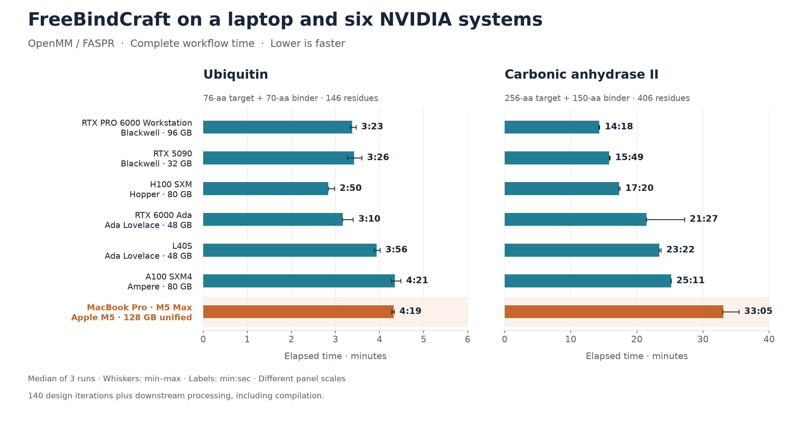
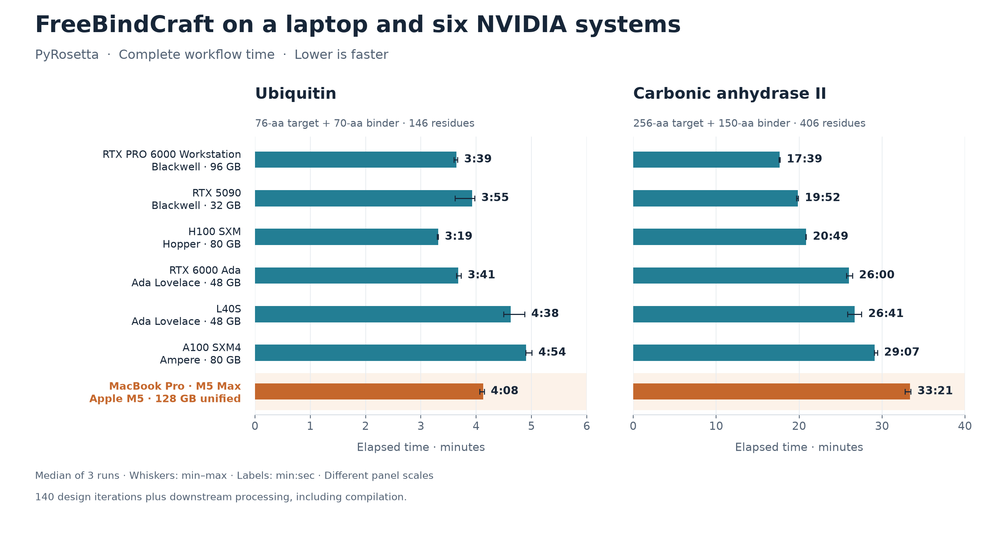
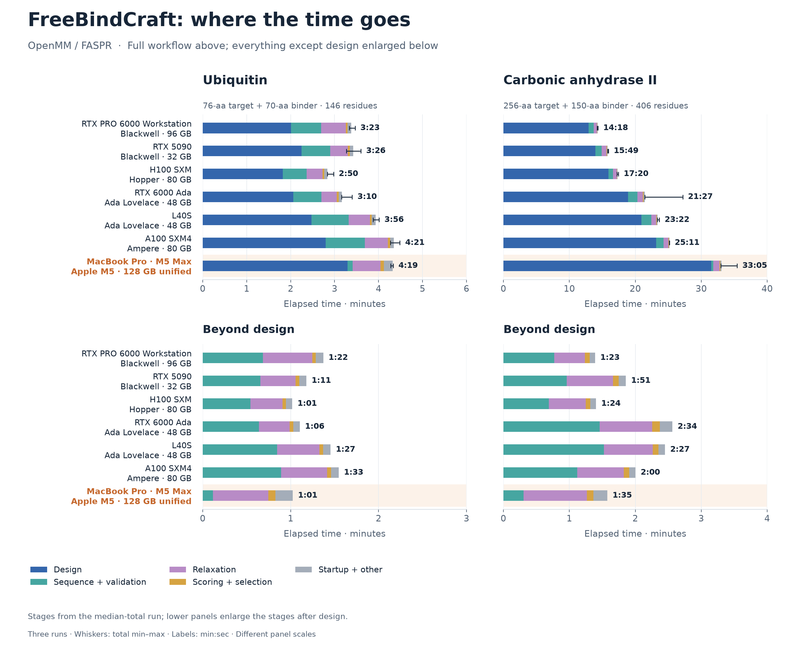
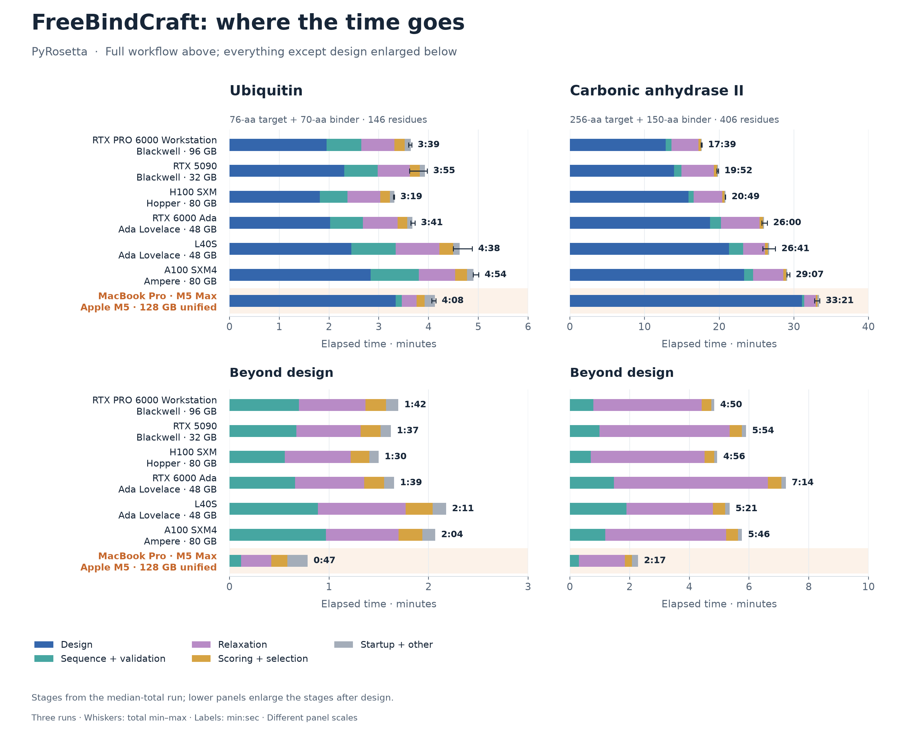

# FreeBindCraft on Apple Silicon and NVIDIA

**The M5 Max brings practical protein design to a laptop.** It completes the small benchmark in about four minutes, comparable to the NVIDIA systems tested. The larger benchmark takes about 33 minutes, with NVIDIA systems finishing in 14–29 minutes.

The MacBook Pro uses the unchunked Metal path, a 40-core GPU and 128 GB unified memory. Each result is the median of three runs, including compilation. Both workloads complete 140 design iterations plus downstream prediction, relaxation and scoring using common fixtures. These timings measure workflow runtime rather than accepted-binder yield.

## Workflow times

The two target/binder sizes appear side by side. Hardware is ordered by the larger workload's runtime, with generation and memory shown beside each device. Whiskers show the observed range; each panel has its own time scale.

### OpenMM / FASPR

### PyRosetta

The Mac is close to the A100 system on the small OpenMM/FASPR workload and faster than the A100 and L40S systems with PyRosetta. NVIDIA leads on the larger workload, with the two Blackwell GPUs finishing fastest.

## Time breakdowns

Design accounts for 93–95% of the Mac's larger-workload runtime. Its short downstream stages help narrow the overall performance gap. Each chart shows the full workflow above and enlarges the remaining stages below.

OpenMM / FASPR breakdown

PyRosetta breakdown

## Hardware

Device names link to manufacturer specifications. FP32 figures are theoretical peak rates; the timings above include both CPU and GPU work.

| Device | Generation | Memory | FP32 TFLOPS | Memory bandwidth |
|---|---|---|---:|---:|
| [RTX PRO 6000 Workstation](https://www.nvidia.com/en-us/products/workstations/professional-desktop-gpus/rtx-pro-6000) | Blackwell | 96 GB GDDR7 | ≈125 | 1,792 GB/s |
| [RTX 5090](https://www.nvidia.com/en-us/geforce/graphics-cards/compare/) | Blackwell | 32 GB GDDR7 | ≈105* | 1,792 GB/s |
| [H100 SXM](https://www.nvidia.com/en-us/data-center/h100) | Hopper | 80 GB | 67 | 3,350 GB/s |
| [RTX 6000 Ada](https://www.nvidia.com/content/dam/en-zz/Solutions/design-visualization/proviz-print-rtx6000-datasheet-web-2504660.pdf) | Ada Lovelace | 48 GB GDDR6 | 91.1 | 960 GB/s |
| [L40S](https://www.nvidia.com/en-us/data-center/l40s) | Ada Lovelace | 48 GB GDDR6 | 91.6 | 864 GB/s |
| [A100 SXM4](https://www.nvidia.com/en-us/data-center/a100) | Ampere | 80 GB HBM2e | 19.5 | 2,039 GB/s |
| [M5 Max](https://support.apple.com/en-us/126318) | Apple M5 | 128 GB unified | — | 614 GB/s |

*RTX 5090 FP32 estimated from core count and boost clock. Apple does not publish an FP32 rate. Mac memory is shared by CPU and GPU. The H100 was tested at a 500 W power cap.*

Benchmarked October 2026.
